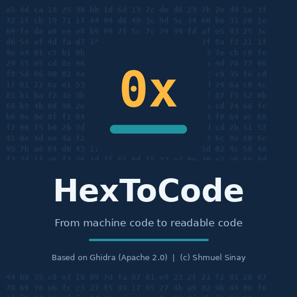

<div dir="rtl">

<p align="center"></p>

# HexToCode

**HexToCode** הוא כלי להנדסה לאחור (Reverse Engineering) של תוכנות מחשב, עם **ממשק מלא בעברית** ו**עוזר AI מובנה**.
הכלי מבוסס על [Ghidra](https://github.com/NationalSecurityAgency/ghidra).

במקום לחטט שעות בקוד, אפשר פשוט לשאול: *"איפה נבדקת הסיסמה?"*, *"מה גורם להודעת השגיאה הזו?"*, *"איזה חלק בתוכנה אחראי על המנויים?"*. העוזר חוקר את הקובץ בעצמו, עונה בעברית ומעביר אותך למקום הנכון בקוד.

**[⬇️ להורדת הגרסה האחרונה](https://github.com/shmuel-sinay/HexToCode/releases)**

## במה זה שונה מ-Ghidra?

| | Ghidra | HexToCode |
|---|---|---|
| כל יכולות ההנדסה לאחור של Ghidra | ✅ | ✅ |
| ממשק בעברית, מימין לשמאל | – | ✅ |
| עוזר AI מובנה (בלי להתקין תוספים) | – | ✅ |
| שאלות ותשובות בעברית על הקוד | – | ✅ |
| תיעוד אוטומטי של כל הפונקציות בעברית | – | ✅ |
| המלצות על קוד מת ועריכה באישור המשתמש | – | ✅ |

## יכולות

### הבסיס: Ghidra
* דה-קומפילציה מאסמבלי לקוד C קריא
* תמיכה בארכיטקטורות רבות: x86/x64, ARM/AArch64, MIPS, PowerPC, RISC-V ועוד
* ניתוח קבצי PE (Windows), ELF (Linux), Mach-O (macOS) וקושחות
* ניתוח אוטומטי: זיהוי פונקציות, מחרוזות, סמלים והפניות צולבות
* גרפים של זרימת קוד ושל קריאות בין פונקציות
* עריכת סוגי נתונים ומבנים, Patching ברמת הבתים והפקודות
* דיבאגר, וסקריפטים ב-Java וב-Python

### ממשק בעברית
* תפריטים, חלונות, כפתורים, הגדרות ותיאורי כלים בעברית. התפריטים מוצגים מימין לשמאל.
* מידע מהקובץ שמנתחים (שמות פונקציות, כתובות, מחרוזות) נשאר כמו שהוא ולא מתורגם.
* אפשר לחזור לאנגלית בכל רגע. הפרטים ב-[HEBREW.md](HEBREW.md).

### עוזר AI (חלון > עוזר AI)
* **שאלות בעברית:** העוזר מחפש פונקציות, מחרוזות וסמלים, עוקב אחרי הפניות ואחרי מי קורא למי, מפענח לקוד C ומנווט אותך למקום שמצא. בזמן העבודה הוא מציג כל צעד שהוא עושה.
* **הסבר פונקציה** ו**הצעת שמות** לפונקציה שבה נמצא הסמן.
* **זיהוי קוד מת:** פונקציות שאף אחד לא קורא להן, והמלצות מה אפשר למחוק או לנטרל.
* **עריכה באישורך:** שינוי שמות, חתימות, הערות בעברית, תוויות, Patch ומחיקת פונקציות. כל שינוי מוצג לאישור, ואפשר לבטל אותו עם Ctrl+Z.
* **"תעד הכל בעברית":** כותב הערה בעברית מעל כל פונקציה.
* **ייצוא:** קובץ מתוקן שאפשר להריץ מיד, או את כל התוכנית כקוד C.
* **ספקים:** Anthropic Claude, Google AI Studio (Gemini), OpenAI, וכל שירות שתואם ל-OpenAI (OpenRouter, DeepSeek ועוד). אפשר גם להשתמש ב**מודל מקומי** (Ollama, LM Studio), וכך הקוד לא יוצא מהמחשב שלך.

פירוט מלא: [Ghidra/Extensions/AIAssistant/README.md](Ghidra/Extensions/AIAssistant/README.md).

## התקנה

ב[דף ההורדות](https://github.com/shmuel-sinay/HexToCode/releases) יש שני סוגי קבצים:

* **עם Java בפנים, הכי פשוט:** `HexToCode-<גרסה>-windows-with-java.zip`, או הגרסאות ל-`linux` ול-`macos`. לא צריך להתקין שום דבר נוסף.
* **בלי Java, קובץ קטן יותר לכל המערכות:** `HexToCode-<גרסה>.zip`. צריך להתקין קודם **Java (JDK) גרסה 25, 64 ביט**, למשל מ-[Adoptium](https://adoptium.net).

אחרי ההורדה:
1. פתח את הקובץ לתיקייה.
2. הפעל:
   * **Windows:** `HexToCode.bat`
   * **Linux / macOS:** `./HexToCode`

אפשר לוודא שההורדה תקינה לפי קובץ ה-`.sha256` שמצורף.

## הגדרת עוזר ה-AI

1. פתח קובץ לניתוח: **קובץ > ייבא קובץ**. אחר כך פתח אותו בדפדפן הקוד ואשר את הניתוח האוטומטי.
2. **עריכה > אפשרויות הכלי > עוזר AI**:
   * בחר **ספק AI**.
   * הדבק **מפתח API**. אפשר גם להגדיר משתנה סביבה במקום: `ANTHROPIC_API_KEY`, `GEMINI_API_KEY` או `OPENAI_API_KEY`.
   * לשרת מקומי: בחר "OpenAI / שרת תואם OpenAI" וכתוב את הכתובת, למשל `http://localhost:11434/v1` ל-Ollama. לשרת מקומי לא צריך מפתח.
3. **חלון > עוזר AI**, ושאל.

| ספק | מאיפה מקבלים מפתח |
|---|---|
| Claude | [console.anthropic.com](https://console.anthropic.com) |
| Gemini | [aistudio.google.com](https://aistudio.google.com/apikey) |
| OpenAI | [platform.openai.com](https://platform.openai.com/api-keys) |

> **שים לב:** אם משתמשים בשירות AI בענן, הקוד שמנתחים נשלח לשרתים שלו. לקבצים רגישים עדיף להשתמש במודל מקומי.

## בנייה מקוד המקור

נדרשים: JDK 25 ו-Gradle 9.1 ומעלה.

```bash
gradle -I gradle/support/fetchDependencies.gradle
gradle buildGhidra
```

קובץ ההפצה ייווצר בתיקייה `build/dist`. הוראות מפורטות יותר נמצאות ב-[README-Ghidra.md](README-Ghidra.md).

כדי לפרסם מהדורה חדשה, דוחפים תג `v*` (למשל `v1.1.0`), או מפעילים את **Actions > Release HexToCode > Run workflow**. GitHub בונה את התוכנה ל-Windows, ל-Linux ול-macOS ומפרסם את המהדורה.

## רישיון וזכויות יוצרים

**Copyright © 2026 שמואל סיני (Shmuel Sinay) &lt;g47ben@gmail.com&gt;. כל הזכויות שמורות.**

* HexToCode מופץ תחת **רישיון שימוש מוגבל**, שמפורט בקובץ [LICENSE](LICENSE). מותר להוריד, להתקין ולהריץ גרסאות רשמיות לשימוש עצמי. כל שימוש אחר, כמו הפצה, שינוי או שימוש מסחרי, דורש אישור בכתב.
* קוד Ghidra המקורי נשאר תחת רישיון Apache 2.0, ורכיבי צד שלישי נשארים תחת הרישיונות שלהם. ראה [NOTICE](NOTICE) ואת התיקייה [licenses](licenses).
* HexToCode אינו קשור ל-NSA או לספקי ה-AI, ולא מקבל מהם חסות.

## אחריות ושימוש מותר

התוכנה ניתנת "כמו שהיא" (AS IS), בלי אחריות מכל סוג. המפתח אינו אחראי לכל נזק או שימוש לרעה.
השימוש בתוכנה מותר רק לפי החוק ולפי תנאי הרישיון של התוכנות שמנתחים. תשובות של עוזר ה-AI עלולות להיות שגויות, ולכן חשוב לבדוק אותן.

## יצירת קשר

הצעות, באגים ופידבק: דרך [Issues](https://github.com/shmuel-sinay/HexToCode/issues), או במייל g47ben@gmail.com.

אם הפרויקט עזר לך, אשמח ל-⭐ במאגר!

</div>
